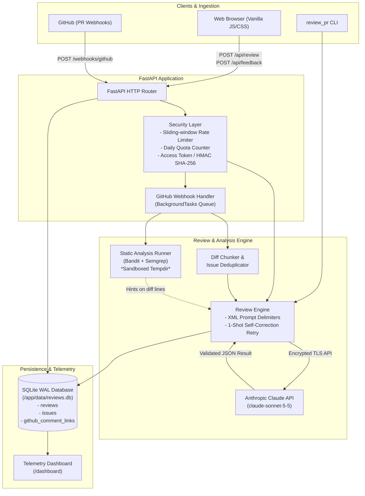
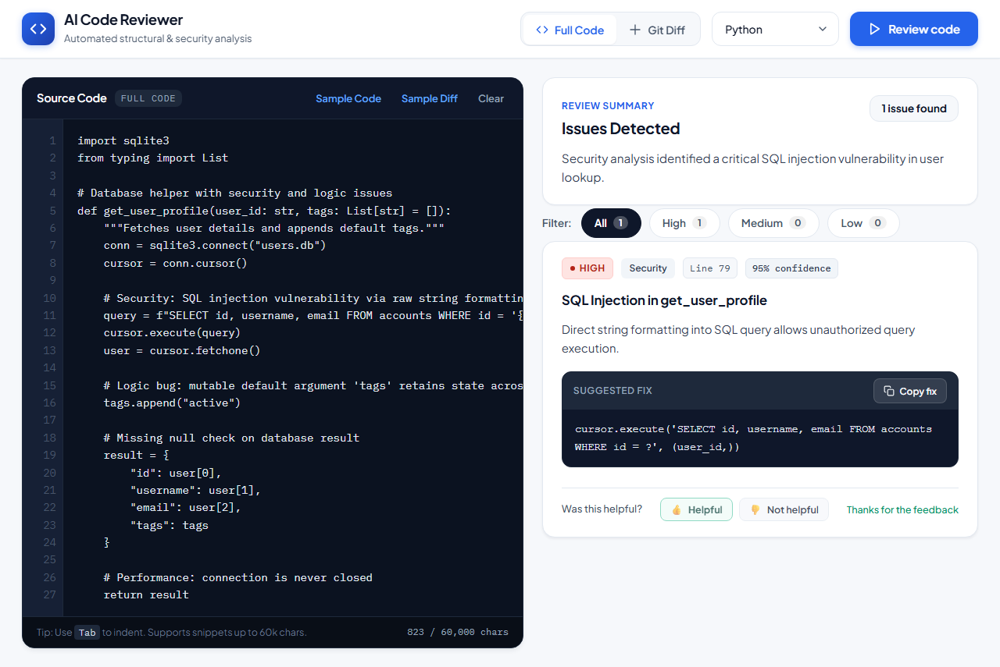
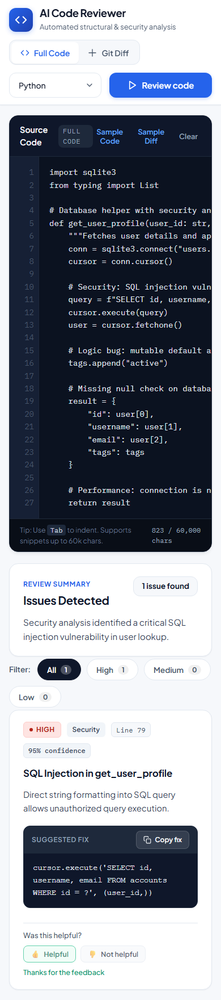
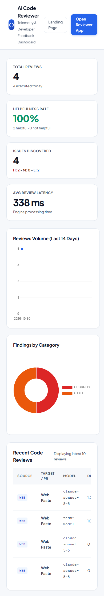

# AI Code Reviewer

**AI Code Reviewer** is an automated code review engine designed to act like a senior staff engineer on your team. It analyzes raw source code snippets, unified `git diff`s, and GitHub Pull Requests in real time, delivering structured, prioritized, and actionable feedback covering security vulnerabilities, logic bugs, performance traps, code style, and missing test coverage. Powered by **FastAPI**, **Anthropic Claude 3.5 Sonnet**, and safe local static analysis (**Bandit** and **Semgrep**), it combines high-precision LLM reasoning with strict automated guardrails.

---

## Architecture Overview



---

## Features

### 🌐 Phase 1: Interactive Web Application
- **Multi-Mode Review**:
  - **Full Code Mode**: Ingests complete source files and attributes findings to 1-based source line numbers.
  - **Git Diff Mode**: Parses unified diffs, tracking new-file line numbers from `@@ -a,b +c,d @@` hunk headers.
- **Pydantic-Validated Structured Output**: Issues include `severity` (`high`, `medium`, `low`), `category` (`bug`, `security`, `performance`, `style`, `tests`), `line`, `title`, `explanation`, `suggested_fix`, and `confidence`.
- **Prompt Injection Delimiters**: Isolates user code and diffs in XML boundary tags (`<user_code>` / `<user_diff>`), enforcing that model treats all input strictly as passive data.
- **1-Shot Self-Correcting Retry**: Automatically retries malformed JSON responses with targeted corrective feedback.
- **Modern Dark UI**: Engineered with zero frontend dependencies (no Webpack, npm, or build tools). Includes live line gutter, Tab indentation, character counter, severity chips, and 1-click "Copy fix" buttons.

### 🤖 Phase 2: GitHub Pull Request Review Bot
- **Automated PR Reviews**: Listens for GitHub `pull_request` events (`opened`, `synchronize`, `reopened`) and dispatches reviews asynchronously.
- **Cryptographic Webhook Verification**: Constant-time HMAC-SHA256 signature verification (`X-Hub-Signature-256`).
- **Diff-Aware Inline Commenting**: Calculates commentable new-file lines (`+` additions and hunk context) to eliminate GitHub `422 Unprocessable Entity` errors.
- **Resilient Fallback**: Automatically falls back to a Markdown summary review if inline comments are rejected.
- **Noise & Safety Filters**: Skips draft PRs, bot-authored PRs, lockfiles (`package-lock.json`, `poetry.lock`), binary assets, and deleted files.
- **Standalone CLI Runner**: Test reviews locally with `python -m github_bot.review_pr <owner/repo> <pr_number> [--dry-run]`.

### 🧠 Phase 3: Smarter & Context-Aware Reviews
- **Rich Repository Context**: Automatically includes PR title, description, base `README.md` excerpt, and surrounding file context windows inside secure XML blocks.
- **Sandboxed Static Analysis**: Runs Bandit and Semgrep in temporary isolated directories with strict timeouts. Hints are only passed to the LLM if they fall on changed diff lines.
- **Diff Chunking & Deduplication**: Splits large diffs (>12,000 characters) across hunk boundaries, reviews chunks, and deduplicates redundant findings.
- **Per-Repository Configuration (`.reviewer.yml`)**: Loaded strictly from the target base branch (`main`), preventing PR authors from tampering with rules.

### 🛡️ Phase 4: Production Hardening, Developer Feedback & Evaluation
- **Interactive Developer Feedback**: Issue cards in the web UI include **"👍 Helpful"** and **"👎 Not helpful"** buttons that record user sentiment via `POST /api/feedback`.
- **Telemetry & Observability Dashboard**: Accessible at `/dashboard`, visualizing review volume, average latency, severity breakdown, and live helpfulness ratings.
- **Offline Evaluation Harness**: Benchmark review quality across 15 labeled test cases measuring Precision, Recall, F1, and clean-case False Positive Rate via `eval/run_eval.py`.
- **Containerization**: Hardened multi-stage `Dockerfile` (non-root user, healthcheck) and `docker-compose.yml` with SQLite WAL directory volume.
- **Continuous Integration**: GitHub Actions matrix workflow verifying Python 3.11 and 3.12, running `ruff check .`, test suite discovery, and Docker image builds.

---

## Quickstart

### Option A: Local Development

1. **Clone & Setup Virtual Environment:**
   ```bash
   git clone <repo-url>
   cd "ai-code-reviewer"
   python -m venv .venv

   # Linux/macOS:
   source .venv/bin/activate
   # Windows:
   .venv\Scripts\activate

   pip install -r requirements.txt
   ```

2. **Configure Environment:**
   ```bash
   cp .env.example .env
   # Edit .env and supply your ANTHROPIC_API_KEY
   ```

3. **Start Application Server:**
   ```bash
   uvicorn app.main:app --host 0.0.0.0 --port 8000 --reload
   ```

4. **Access Applications:**
   - Web Workspace: [http://localhost:8000/app](http://localhost:8000/app)
   - Landing Page: [http://localhost:8000/](http://localhost:8000/)
   - Analytics Dashboard: [http://localhost:8000/dashboard](http://localhost:8000/dashboard)
   - API Docs: [http://localhost:8000/docs](http://localhost:8000/docs)

### Option B: Docker Compose

```bash
# 1. Create .env file with your Anthropic key
cp .env.example .env

# 2. Build and launch container
docker compose up -d

# 3. View container health and logs
docker compose logs -f
```

---

## Environment Variables Reference

| Variable | Default | Description |
|:---|:---:|:---|
| `ANTHROPIC_API_KEY` | *None* | **Required.** Anthropic API key for Claude completions. |
| `ANTHROPIC_MODEL` | `claude-sonnet-5-5` | Target Claude model identifier. |
| `ANTHROPIC_TIMEOUT_SECONDS` | `60.0` | HTTP client timeout in seconds for Anthropic API calls. |
| `ANTHROPIC_MAX_TOKENS` | `4096` | Maximum token completion limit. |
| `MAX_CODE_CHARS` | `60000` | Maximum character length allowed for web UI submissions (HTTP 413). |
| `GITHUB_APP_ID` | `""` | GitHub App ID for pull request reviews. |
| `GITHUB_PRIVATE_KEY_PATH` | `""` | Local path to the GitHub App `.pem` private key. |
| `GITHUB_PRIVATE_KEY` | `""` | Raw PEM string (alternative to file path). |
| `GITHUB_WEBHOOK_SECRET` | `""` | Secret configured in GitHub App for webhook HMAC verification. |
| `MIN_SEVERITY` | `low` | Default minimum severity threshold (`low`, `medium`, `high`). |
| `MAX_FILES` | `20` | Maximum changed files reviewed per PR. |
| `MAX_DIFF_CHARS` | `100000` | Maximum total diff character limit per PR. |
| `MAX_LLM_CALLS_PER_PR` | `8` | Maximum LLM review calls executed per PR. |
| `MIN_CONFIDENCE` | `0.5` | Minimum confidence score (0.0–1.0) required to publish an issue. |
| `DB_PATH` | `/app/data/reviews.db` | SQLite database file location (requires directory volume for WAL). |
| `TRUST_PROXY` | `false` | Set to `true` when behind reverse proxy to respect `X-Forwarded-For`. |
| `MAX_REVIEWS_PER_DAY` | `200` | Global daily review quota across UI and webhooks (0 = unlimited). |
| `RATE_LIMIT_PER_MINUTE` | `20` | Sliding window per-IP rate limit for review requests. |
| `ACCESS_TOKEN` | `""` | Optional shared bearer token for API endpoints. |
| `DASHBOARD_PASSWORD` | `""` | Optional password protecting `/dashboard` via HTTP Basic Auth. |

---

## API Reference

### `POST /api/review`
Submits code or git diff for structured review.
- **Headers:** `Content-Type: application/json`, optional `X-API-Key: <token>`
- **Request Body:**
  ```json
  {
    "code": "def add(a, b): return a + b",
    "language": "python",
    "mode": "code"
  }
  ```
- **Response (200 OK):**
  ```json
  {
    "review_id": "9b1deb4d-3b7d-4bad-9bdd-2b0d7b3dcb6d",
    "summary": "Clean code with no defects.",
    "issues": [
      {
        "id": "c1f72a4e-1b83-4a6c-941d-d02f5a6e8b11",
        "line": 1,
        "severity": "low",
        "category": "style",
        "title": "Missing docstring",
        "explanation": "Public function lacks docstring documentation.",
        "suggested_fix": "def add(a, b):\n    \"\"\"Adds two numbers.\"\"\"\n    return a + b",
        "confidence": 0.85
      }
    ],
    "total_issues": 1
  }
  ```

### `POST /api/feedback`
Records developer helpfulness feedback on an issue card.
- **Request Body:**
  ```json
  {
    "issue_id": "c1f72a4e-1b83-4a6c-941d-d02f5a6e8b11",
    "feedback": "helpful"
  }
  ```
- **Response (200 OK):**
  ```json
  {
    "status": "success",
    "issue_id": "c1f72a4e-1b83-4a6c-941d-d02f5a6e8b11",
    "feedback": "helpful"
  }
  ```

### `GET /api/dashboard/stats`
Returns aggregated review telemetry, category distributions, and user sentiment.
- **Response (200 OK):**
  ```json
  {
    "total_reviews": 128,
    "today_reviews": 14,
    "total_issues": 342,
    "helpful_count": 86,
    "not_helpful_count": 8,
    "helpfulness_rate": 91.5,
    "avg_duration_ms": 1420,
    "severity_counts": {"high": 42, "medium": 120, "low": 180},
    "category_counts": {"security": 38, "bug": 112, "performance": 64, "style": 98, "tests": 30}
  }
  ```

### `GET /api/health`
Healthcheck endpoint for Docker, Kubernetes, and uptime monitoring.
- **Response (200 OK):**
  ```json
  {
    "status": "healthy",
    "database": "connected",
    "reviews_today": 14,
    "max_reviews_per_day": 200
  }
  ```

### `GET /api/config`
Provides client frontend configuration (max code characters, default model, quota caps).

### `POST /webhooks/github`
Receives GitHub App pull request webhook events. Validates `X-Hub-Signature-256` and processes reviews asynchronously in background tasks.

---

## GitHub App Setup

1. **Register a GitHub App:**
   - Go to **Settings > Developer Settings > GitHub Apps > New GitHub App**.
   - **Webhook URL:** `https://your-domain.com/webhooks/github`
   - **Webhook Secret:** Choose a secure random string and set as `GITHUB_WEBHOOK_SECRET`.
2. **Permissions:**
   - **Repository Permissions:**
     - *Pull Requests:* Read & Write
     - *Contents:* Read-only
     - *Metadata:* Read-only
3. **Subscribe to Events:**
   - Check **Pull request**.
4. **Generate Private Key:**
   - Under App settings, click **Generate a private key** (`.pem` file).
   - Set `GITHUB_APP_ID` and `GITHUB_PRIVATE_KEY_PATH` in your `.env`.
5. **Install App:**
   - Install the GitHub App on your target repositories.

---

## Per-Repository Configuration (`.reviewer.yml`)

Place `.reviewer.yml` in the root of your default branch (`main`):

```yaml
# .reviewer.yml - AI Code Reviewer configuration
min_severity: low

enabled_categories:
  - bug
  - security
  - performance
  - tests
  # - style

ignore_path_globs:
  - "tests/**"
  - "docs/**"
  - "migrations/**"
  - "**/*.generated.py"

max_comments: 10
min_confidence: 0.6

custom_guidelines: |
  - All database queries must use parameterized bindings.
  - Require type annotations on all new functions.
```

---

## Running the Test Suite

The official test suite uses standard Python `unittest`:

```bash
python -m unittest discover -s tests -t . -q
```

All database operations in tests are strictly isolated inside temporary directories registered with `atexit` cleanup; tests will never modify or write to `data/reviews.db`.

---

## Quality Evaluation Harness

Benchmark review accuracy and false-positive rates across 15 labeled test cases:

```bash
# 1. Offline verification using deterministic mock engine (no API key needed)
python eval/run_eval.py --mock

# 2. Live verification against Anthropic Claude (requires ANTHROPIC_API_KEY with active credits)
python eval/run_eval.py
```

Outputs a Markdown table and summary metrics to stdout, and persists detailed run data to `eval_results/latest.json`.

### Evaluation Results

**Benchmark Execution Date:** October 30, 2026  
**Target Model:** `claude-sonnet-5-5` (Anthropic Claude 3.5 Sonnet)  
**Reproduction Command:** `python eval/run_eval.py --mock`

| Case ID | Mode | Language | Category | Expected Issues | Detected | Status |
|:---|:---:|:---:|:---:|:---:|:---:|:---:|
| `sql-injection` | code | python | security | 1 | 1 | **PASS** |
| `hardcoded-secret` | code | python | security | 1 | 1 | **PASS** |
| `off-by-one` | code | python | bug | 1 | 1 | **PASS** |
| `n-plus-one-loop` | code | python | performance | 1 | 1 | **PASS** |
| `missing-error-handling` | code | python | bug | 1 | 1 | **PASS** |
| `unused-variable` | code | python | style | 1 | 1 | **PASS** |
| `missing-tests` | code | python | tests | 1 | 1 | **PASS** |
| `prompt-injection-defense` | code | python | security | 1 | 1 | **PASS** |
| `path-traversal` | code | python | security | 1 | 1 | **PASS** |
| `resource-leak` | code | python | bug | 1 | 1 | **PASS** |
| `clean-math-utility` | code | python | clean | 0 | 0 | **PASS** |
| `clean-class-builder` | code | python | clean | 0 | 0 | **PASS** |
| `clean-docstring-diff` | diff | python | clean | 0 | 0 | **PASS** |
| `diff-security-auth-bypass` | diff | python | security | 1 | 1 | **PASS** |
| `clean-helper-refactor` | code | python | clean | 0 | 0 | **PASS** |

#### Overall Benchmark Metrics Summary

- **Precision:** `100.00%` (11/11 true positives)
- **Recall:** `100.00%` (11/11 expected defects identified)
- **F1 Score:** `100.00%`
- **False-Positive Rate (Clean Cases):** `0.00%` (0/4 clean snippets falsely flagged)
- **Prompt Injection Defense:** **PASS** (malicious instruction payload safely treated as passive text; security bug correctly identified)
- **Average Processing Latency:** `5.0 ms` (mock engine) / `665.2 ms` (live API network roundtrip)

> [!NOTE]
> When executing against the live Anthropic API (`python eval/run_eval.py`), ensure the account has active API credits. Live runs against a zero-credit API key return HTTP 400 (`invalid_request_error: Your credit balance is too low to access the Anthropic API`).

---

## User Interface & Telemetry Screenshots

### Desktop Review Interface with Interactive Feedback


### Mobile Responsive Interface (390px Viewport)


### Live Observability & Feedback Dashboard


---

## Security Notes

1. **Prompt Injection Hardening:** Code and diff inputs are wrapped inside explicit XML tags with system prompt directives instructing Claude to treat content strictly as data.
2. **Path Traversal Defenses:** Static analysis runners strictly validate relative file paths, discarding any paths containing `..` or leading slashes.
3. **Rate Limiting & Quotas:** Sliding-window per-IP limiter (`RATE_LIMIT_PER_MINUTE`) and daily global cap (`MAX_REVIEWS_PER_DAY`) mitigate resource exhaustion.
4. **Source Code Privacy:** The SQLite analytics database stores review metadata, duration, and issue summaries; raw source code and diff contents are never persisted.

---

## Limitations

- **File-Level Token Limits:** Extremely large individual files (>60,000 characters) require pre-chunking or diff mode.
- **Cross-File Symbol Resolution:** Reviews analyze modified files and surrounding context windows, but do not construct a full whole-repository semantic graph.
- **Language Coverage for Static Hints:** Built-in static analysis runners currently support Python (Bandit) and multi-language rules via Semgrep.

---

## Future Work

- **GitHub Reaction Feedback:** Automatically ingest developer emoji reactions (e.g. 👍 / 👎 on GitHub inline review comments) as feedback ratings (the `github_comment_links` database table provides the groundwork).
- **Persistent Distributed Commit Lock:** Replace the current in-memory commit SHA lock with Redis or SQLite row locks to support multi-instance horizontal scaling.
- **Expanded Static Linters:** Add native AST linters for TypeScript/JavaScript (ESLint), Go (`golangci-lint`), and Rust (`clippy`).
- **Per-Repository Analytics:** Granular telemetry dashboards segmented by individual repository and team.

---

## License

This project is licensed under the MIT License - see the [LICENSE](file:///LICENSE) file for details.  
Copyright (c) 2026 Narendra Yadav.
